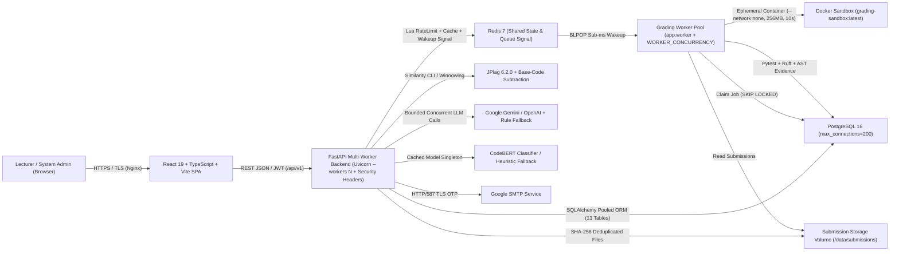
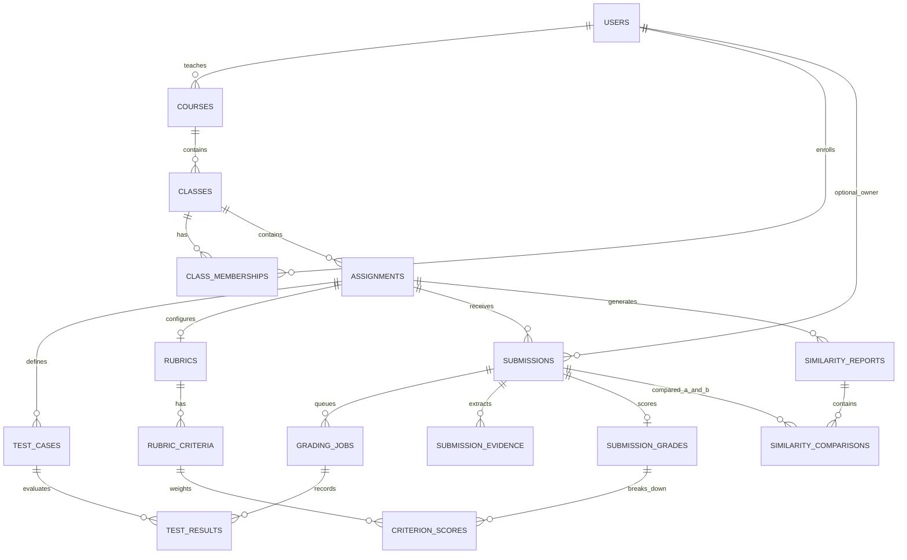
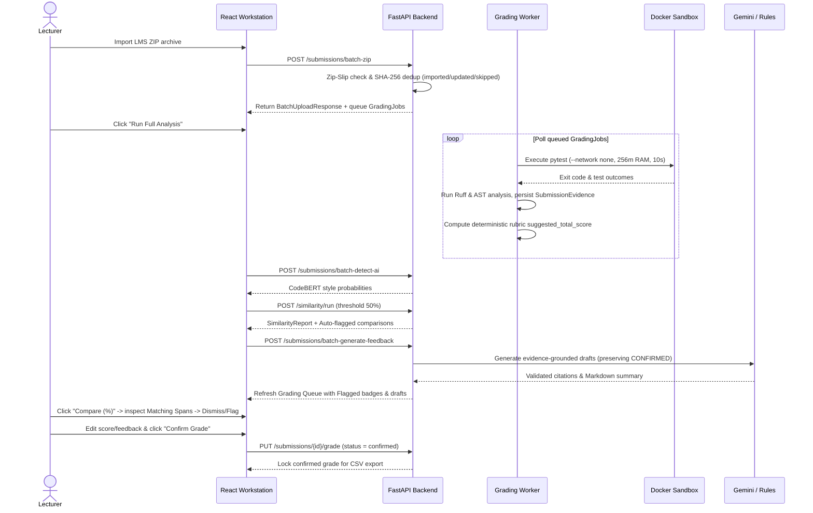

# Technical Diagrams & Reference Tables for VeriPie Report

Tài liệu này tổng hợp đầy đủ các sơ đồ chuẩn (Mermaid) và bảng đặc tả phục vụ Chương 3 (Phân tích yêu cầu), Chương 4 (Thiết kế hệ thống) và Chương 6 (Kiểm thử & Đánh giá). Bạn có thể copy các khối Mermaid vào Mermaid Live Editor / Draw.io để xuất ảnh sắc nét chèn vào Word.

---

## 1. Sơ đồ Kiến trúc Hệ thống (System Architecture Diagram - Chương 4.1)

Hệ thống theo mô hình Client-Server tách tầng rõ ràng giữa SPA Frontend, REST API Backend (FastAPI), Background Worker chấm bài và Sandbox Container cô lập mạng.

---

## 2. Sơ đồ Tổng quan Chức năng theo Vai trò (Use Case Flow - Chương 3.3)

Ứng dụng quản lý 2 nhóm tài khoản đăng nhập (`Lecturer` và `System Admin`). Sinh viên không đăng nhập trực tiếp mà được quản lý qua dữ liệu bài nộp (`student_identifier`, `student_name`).

```mermaid
flowchart TD
    LEC["Lecturer / Instructor"] --> L1["Register / Verify OTP / Login / Reset Password"]
    LEC --> L2["Manage Courses, Classes and Assignments"]
    LEC --> L3["Configure Pytest TestCases and Weighted Rubric (100%)"]
    LEC --> L4["Batch Import LMS ZIP (SHA-256 Dedup & Overwrite)"]
    LEC --> L5["Run Full Analysis (Grade + AI Signal + Similarity Auto-Flag + Batch Feedback)"]
    LEC --> L6["Inspect Evidence, Compare Similarity Modal, Override/Confirm Grades"]
    LEC --> L7["Export Gradebook CSV"]

    ADM["System Admin (Isolated Portal)"] --> A1["View System KPIs, Pipeline & Course Charts"]
    ADM --> A2["Retry Failed Grading Jobs"]
    ADM --> A3["Manage Users (Create, Role, Lock/Unlock, Force Delete)"]
    ADM --> A4["Audit and Purge Platform Courses / Classes"]
    ADM --> A5["Inspect Database, Storage & Worker Queue Health"]
```

---

## 3. Sơ đồ Thực thể Kết hợp (Database ERD - Chương 4.2)

Cơ sở dữ liệu gồm 13 bảng chính quản lý từ định danh người dùng, cấu trúc môn học, nộp bài, chấm tự động đến báo cáo tương đồng.

---

## 4. Biểu đồ Tuần tự Luồng Chấm & Duyệt Điểm (Sequence Diagram - Chương 3.3 / 4.1)

---

## 5. Bảng Mô tả Nhóm API Chính (API Design Reference - Chương 4.4)

| Nhóm API | Method & Endpoint (`/api/v1`) | Quyền truy cập | Chức năng chính |
| :--- | :--- | :--- | :--- |
| Health | `GET /health` | Public | Kiểm tra tình trạng Backend + Redis (`connected`/`disabled`) + Security Headers |
| Auth | `POST /auth/register`, `POST /auth/verify-otp`, `POST /auth/login/json` | Public (Rate-limited) | Đăng ký OTP Gmail, đăng nhập JWT, thông báo khóa kèm email hỗ trợ |
| Auth | `POST /auth/forgot-password`, `POST /auth/reset-password`, `PATCH /auth/me` | Public / Auth | Khôi phục mật khẩu OTP, cập nhật hồ sơ & đổi mật khẩu |
| Courses & Classes | `GET/POST/DELETE /courses`, `/courses/{id}/classes` | Lecturer / Admin | CRUD khóa học & lớp học kèm cascade purge an toàn |
| Assignments & Tests | `GET/POST/PATCH/DELETE .../assignments`, `.../test-cases` | Lecturer / Admin | Quản lý bài tập, starter `base_code` và bộ test public/hidden |
| Submissions | `POST .../submissions`, `.../batch-zip`, `DELETE .../submissions/{id}` | Lecturer | Upload đơn lẻ / ZIP hàng loạt (SHA-256 dedup), xóa 1 hoặc toàn bộ bài (`DELETE .../submissions`) |
| Grading & Evidence | `POST .../submissions/{id}/grade`, `GET .../evidence`, `GET/PUT .../submissions/{id}/grade` | Lecturer | Chạy/chấm lại sandbox, xem bằng chứng dòng code, xác nhận điểm |
| Integrity & AI | `POST .../similarity/run`, `PUT .../reports/{rid}/comparisons/{cid}`, `POST .../submissions/batch-detect-ai` | Lecturer | Chạy JPlag/Winnowing (Auto-Flag >= threshold), duyệt Flag/Dismiss, CodeBERT |
| Feedback & Export | `POST .../feedback/generate`, `POST .../submissions/batch-generate-feedback`, `GET .../gradebook-csv` | Lecturer | Tạo nháp nhận xét đơn lẻ / hàng loạt (giữ nguyên CONFIRMED), xuất bảng điểm CSV |
| Admin Portal | `GET /admin/overview`, `/admin/health`, `POST/PATCH/DELETE /admin/users`, `POST /admin/jobs/{id}/retry` | Admin Only | Thống kê toàn hệ thống, quản lý user (cảnh báo force delete), retry job, audit course/class |

---

## 6. Bảng Kết quả Kiểm thử Hiệu năng HTTP Đối chứng (Chương 6)

Thực hiện bằng `scripts/load_stress_test.py` (Async HTTPx workers) so sánh cấu hình **Trước nâng cấp** (`self-contained-uvicorn-single-worker`, `docs/load_test_results.json`) và **Sau nâng cấp** (`docker-cluster-4workers-redis-postgres`: 4 Uvicorn workers + Redis 7 + PostgreSQL 16 trong Docker, `docs/load_test_multiworker_results.json`):

| Giai đoạn kiểm thử | CCU | Requests | 1 Worker (RPS / P50 / P95) | 4 Workers + Redis + Postgres (RPS / P50 / P95) | Cải thiện RPS & P95 | Lỗi HTTP |
| :--- | :---: | :---: | :---: | :---: | :---: | :---: |
| Load Test (Tải chuẩn) | 10 | 200 | 88.78 RPS / 75.28 ms / 365.00 ms | **130.67 RPS / 57.73 ms / 145.41 ms** | **+47.2% RPS, -60.2% P95** | 0.0% |
| Stress Test (Mức cao) | 30 | 300 | 56.63 RPS / 377.74 ms / 1349.15 ms | **80.40 RPS / 222.15 ms / 1070.23 ms** | **+42.0% RPS, -41.2% P50** | 0.0% |
| Stress Test (Đỉnh 60 CCU) | 60 | 600 | 55.49 RPS / 745.71 ms / 2998.61 ms | **69.18 RPS / 587.90 ms / 2390.80 ms** | **+24.7% RPS, -20.3% P95** | 0.0% |
| Endurance (10s liên tục) | 10 | 1065 -> 1148 | 105.88 RPS / 66.16 ms / 255.45 ms | **113.69 RPS / 58.95 ms / 250.86 ms** | **+7.4% RPS, ổn định P50 < 60ms** | 0.0% |

**Nhận xét phân tích**: Hệ thống đạt 0.0% lỗi HTTP trên cả 2 cấu hình ở toàn bộ 4 kịch bản. Sau khi nâng cấp cụm đa worker kết hợp Redis cache và PostgreSQL connection pool, thông lượng (RPS) tăng **+24.7% đến +47.2%** và độ trễ đuôi P95 ở tải chuẩn 10 CCU giảm sâu từ `365.00 ms` xuống còn `145.41 ms` (`-60.2%`) dù phải đi qua network bridge của Docker và truy vấn PostgreSQL thật (kèm Redis Lua rate-limit hoạt động chính xác: chặn request thứ 21/22 ở mọi worker). Khi mở rộng phần cứng lên máy chủ nhiều nhân CPU, chỉ cần tăng `UVICORN_WORKERS` và `WORKER_CONCURRENCY` (hoặc scale container `worker`) mà không phải sửa mã nguồn.
